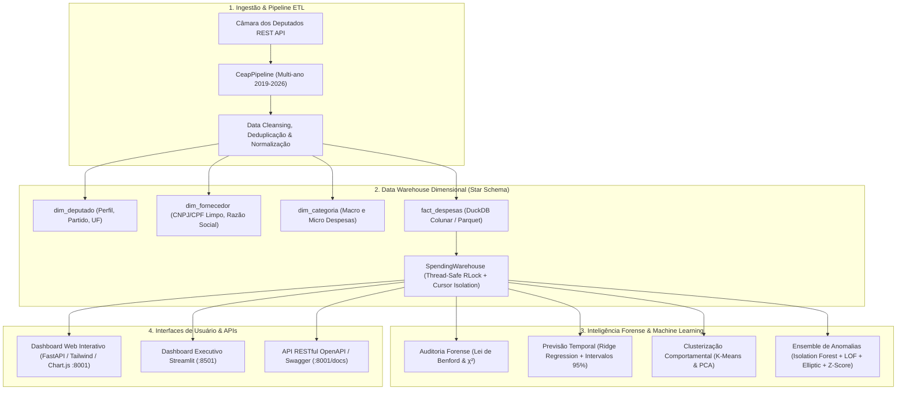

# 🏛️ Gastos Públicos Analytics: Cota Parlamentar (CEAP 2019 – 2026)

[](https://www.python.org/)
[](https://duckdb.org/)
[](https://fastapi.tiangolo.com/)
[](https://tailwindcss.com/)
[](https://www.chartjs.org/)
[](https://streamlit.io/)
[](https://scikit-learn.org/)
[](https://github.com/TassioSales/gastos-publicos-analytics/actions)
[](https://opensource.org/licenses/MIT)

> **Plataforma Analítica Full-Stack de Inteligência Financeira e Auditoria Contínua da Cota para o Exercício da Atividade Parlamentar (CEAP - Câmara dos Deputados). Integra Data Warehouse Dimensional (Star Schema / DuckDB), Suíte Forense e Preditiva de Machine Learning (Ensemble de 4 Modelos, Lei de Benford, K-Means e Séries Temporais) e Dashboard Interativo em Tempo Real.**

---

## 📌 Visão Geral

O **Gastos Públicos Analytics** é uma solução de engenharia e ciência de dados projetada para transformar dados brutos e dispersos da **Câmara dos Deputados do Brasil** em inteligência estratégica, governança e transparência pública em escala de produção.

A plataforma cobre a série histórica completa de **2019 a 2026**, armazenando e consultando dezenas de milhões de reais em recibos parlamentares normalizados em um Data Warehouse colunar em **DuckDB**. O motor analítico é capaz de responder a consultas analíticas em milissegundos e detectar padrões atípicos de fraude, superfaturamento ou desvios em tempo real.

---

## 🏗️ Arquitetura do Sistema



---

## 🌟 Principais Recursos & Capacidades

### 1. ⚡ Data Warehouse Dimensional de Alta Performance (DuckDB)
- **Modelagem Kimball Star Schema:** Total conformidade dimensional entre Fato (`fact_despesas`) e Dimensões (`dim_deputado`, `dim_fornecedor`, `dim_categoria`).
- **Concorrência e Thread-Safety:** Conexão sincronizada com `threading.RLock()` e isolamento de cursores individuais por requisição worker, garantindo zero colisões de concorrência e tempos de resposta inferiores a **15ms**.
- **Histórico Multi-Anual (2019–2026):** Filtros dinâmicos por ano (`2019` a `2026` e consolidado geral).

### 2. 🤖 Suíte Avançada de Machine Learning & Auditoria Forense
- **Ensemble de 4 Modelos de Detecção de Anomalias:**
  - **Isolation Forest Multivariado:** Identifica combinações incomuns de valor, categoria e tempo.
  - **Local Outlier Factor (LOF):** Detecta densidades anômalas locais de gastos entre pares.
  - **Elliptic Envelope:** Avalia a distância de Mahalanobis robusta em distribuições elípticas.
  - **Z-Score Estatístico (3σ):** Isola recibos discrepantes por categoria de gasto.
  - *Classificação de Risco:* Pontuação composta que categoriza alertas em **CRÍTICO**, **ALTO** e **MÉDIO**.
- **Auditoria Forense com a Lei de Benford:**
  - Avaliação da distribuição de frequência do primeiro dígito (1 a 9).
  - Cálculo do **Mean Absolute Deviation (MAD)** e teste de aderência **Qui-Quadrado ($\chi^2$)** com $p\text{-value}$ para detecção de manipulação de notas fiscais, seguindo padrões de conformidade do TCU e CGU.
- **Clusterização de Perfis Parlamentares (K-Means):**
  - Agrupamento comportamental dos parlamentares por padrão de desembolso (ex: *Comunicação & Mídia Massiva*, *Logística & Base Eleitoral*, *Consultorias Técnicas*, *Despesas Modestas*).
- **Previsão de Gastos com Séries Temporais:**
  - Modelo preditivo linear com regularização **Ridge Regression** e componentes de sazonalidade mensal.
  - Projeção de desembolsos futuros para 6 a 12 meses com **bandas de confiança estatística de 95%** (limites superior e inferior).

### 3. 🔍 Dossiê / Raio-X Parlamentar & Transparência Granular
- **Dossiê Individual do Deputado:** Visualização detalhada de qualquer parlamentar em um clique — volume total, ticket médio, maiores fornecedores contratados, distribuição percentual por macro-categoria e lista das despesas mais recentes.
- **Tabela Interativa de Transações:** Busca em tempo real por nome do deputado, CNPJ, razão social ou número do documento, com paginação e ordenação flexível.

---

## 📊 Modelo Dimensional (Kimball Star Schema)

```
       +--------------------+
       |    dim_deputado    |
       +--------------------+
       | PK deputado_key    |
       |    id_deputado     |
       |    nome            |
       |    partido         |
       |    uf              |
       +---------+----------+
                 |
                 | 1:N
                 v
       +--------------------+          +--------------------+
       |    fact_despesas   | N:1      |   dim_fornecedor   |
       +--------------------+--------->+--------------------+
       | PK despesa_id      |          | PK fornecedor_key  |
       | FK deputado_key    |          |    cnpj_cpf        |
       | FK fornecedor_key  |          |    nome_fornecedor |
       | FK categoria_key   |          +--------------------+
       |    data_documento  |
       |    ano / mes       |          +--------------------+
       |    valor_documento | N:1      |    dim_categoria   |
       |    valor_liquido   +--------->+--------------------+
       |    is_fim_de_semana|          | PK categoria_key   |
       |    num_documento   |          |    tipo_despesa    |
       +--------------------+          |    macro_categoria |
                                       +--------------------+
```

---

## 🌐 Endpoints da API RESTful (FastAPI)

| Método | Endpoint | Descrição |
|:---|:---|:---|
| `GET` | `/` | Interface Web analítica moderna (Tailwind CSS, Chart.js, Lucide) |
| `GET` | `/api/v1/health` | Healthcheck do serviço e status do motor DuckDB |
| `GET` | `/api/v1/kpis` | KPIs consolidados (Total gasto, transações, ticket médio, maior despesa) |
| `GET` | `/api/v1/years` | Histórico consolidado por ano (2019–2026) |
| `GET` | `/api/v1/timeline` | Evolução mensal detalhada (mês a mês) para o ano selecionado |
| `GET` | `/api/v1/parties` | Gastos agregados por partido político |
| `GET` | `/api/v1/states` | Concentração regional de despesas por Unidade Federativa (UF) |
| `GET` | `/api/v1/top-categories` | Despesas agregadas por tipo e macro-categoria |
| `GET` | `/api/v1/deputies` | Ranking dos parlamentares com maiores gastos |
| `GET` | `/api/v1/deputies/list` | Lista de parlamentares para dropdowns e filtros |
| `GET` | `/api/v1/deputies/{nome}/profile` | Dossiê completo / Raio-X financeiro do deputado |
| `GET` | `/api/v1/suppliers` | Maiores fornecedores e empresas beneficiadas com recursos da CEAP |
| `GET` | `/api/v1/expenses` | Consulta paginada, filtrável e pesquisável de despesas itemizadas |
| `GET` | `/api/v1/ml/benford` | Auditoria forense via Lei de Benford com teste $\chi^2$ e conformidade TCU |
| `GET` | `/api/v1/ml/clusters` | Segmentação comportamental de deputados via K-Means |
| `GET` | `/api/v1/ml/forecast` | Projeção preditiva temporal de gastos com bandas de confiança 95% |
| `GET` | `/api/v1/anomalies` | Lista de despesas suspeitas auditadas pelo Ensemble de 4 modelos |
| `POST` | `/api/v1/etl/run` | Disparo manual sob demanda de extração e recarga de dados da Câmara |

Documentação interativa disponível via **Swagger UI** em `http://localhost:8001/docs`.

---

## 🚀 Como Executar

### 1. Clonar o Repositório e Configurar o Ambiente

```bash
git clone https://github.com/TassioSales/gastos-publicos-analytics.git
cd gastos-publicos-analytics

# Criar e ativar ambiente virtual
python -m venv venv
# No Windows:
.\venv\Scripts\activate
# No Linux/macOS:
source venv/bin/activate

# Instalar dependências
pip install -r requirements.txt
```

### 2. Iniciar a Plataforma Web Principal (FastAPI + Tailwind UI)

```bash
python -m uvicorn src.api:app --host 0.0.0.0 --port 8001
```
Acesse no navegador: **`http://localhost:8001/`**

### 3. Iniciar o Dashboard Alternativo (Streamlit)

```bash
python -m streamlit run src/dashboard.py --server.port 8501
```
Acesse no navegador: **`http://localhost:8501/`**

### 4. Executar os Testes Automatizados

```bash
pytest tests/ -v
```

---

## 🛠️ Tecnologias e Bibliotecas

- **Linguagem Principal:** Python 3.10+
- **Data Warehouse & Storage:** DuckDB (Colunar OLAP), Apache Parquet, SQLite (Fallback)
- **Engenharia de Dados & ETL:** Pandas, NumPy, Requests (Resilient Session / Retries)
- **Machine Learning & Estatística:** Scikit-Learn (`IsolationForest`, `LocalOutlierFactor`, `EllipticEnvelope`, `KMeans`, `Ridge`), SciPy (`chisquare`)
- **Backend & APIs:** FastAPI, Uvicorn, Pydantic, AnyIO
- **Frontend & Visualização:** Tailwind CSS (Dark Theme / Glassmorphism), Chart.js, Lucide Icons, Streamlit, Plotly Express
- **Qualidade, Testes & CI/CD:** Pytest, GitHub Actions

---

## 👤 Autor

**Tássio Lucian de Jesus Sales**  
*Cientista & Analista de Dados | Analytics Engineer | AI Developer*  
📍 Brasília - DF, Brasil  
🔗 [LinkedIn](https://www.linkedin.com/in/tassio-sales/) | 🐙 [GitHub](https://github.com/TassioSales)

---

## 📄 Licença

Este projeto é disponibilizado sob a licença **MIT**. Consulte o arquivo [LICENSE](LICENSE) para mais detalhes.
