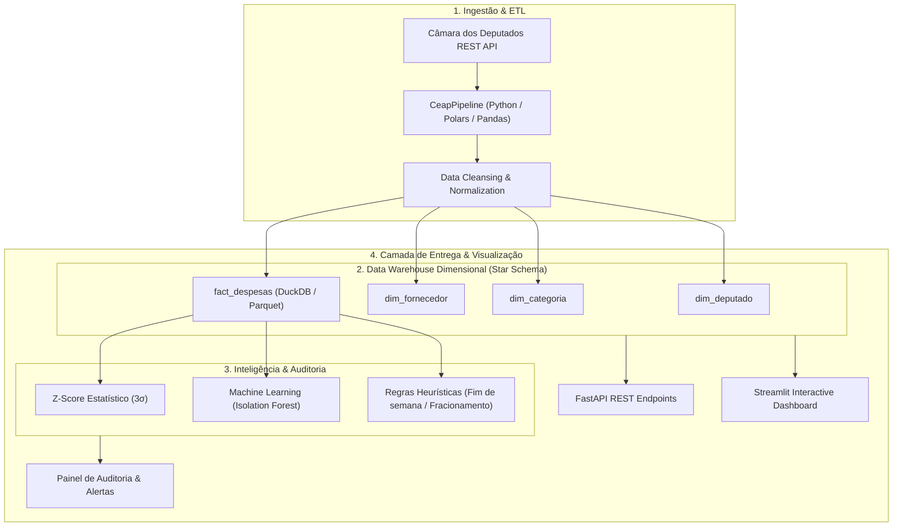

# 🏛️ Gastos Públicos Analytics (CEAP)

[](https://www.python.org/)
[](https://duckdb.org/)
[](https://fastapi.tiangolo.com/)
[](https://streamlit.io/)
[](https://github.com/TassioSales/gastos-publicos-analytics/actions)
[](https://opensource.org/licenses/MIT)

> **End-to-End Analytics Pipeline, Star Schema Data Warehouse (DuckDB/Parquet), and Machine Learning Anomaly Detection on Brazilian Parliamentary Expenses (CEAP / Dados Abertos).**

---

## 📌 Visão Geral do Projeto

O **Gastos Públicos Analytics** é uma plataforma analítica robusta desenvolvida para monitorar, auditar e extrair inteligência a partir dos dados abertos da **Câmara dos Deputados** do Brasil.

O sistema processa a **Cota para o Exercício da Atividade Parlamentar (CEAP)**, estruturando milhões em gastos públicos em um modelo dimensional analítico (Star Schema) otimizado com **DuckDB** e **Parquet**, aplicando algoritmos estatísticos e **Isolation Forest (Machine Learning)** para detectar automaticamente comportamentos atípicos, fracionamentos e potenciais irregularidades.

---

## 🏗️ Arquitetura do Sistema



---

## 🌟 Principais Recursos

1. **Pipeline ETL Resiliente:**
   - Extração automática de deputados, partidos e recibos fiscais com paginação e rate-limiting.
   - Normalização de tipos de dados, deduplicação por hash de documento e tratamento de nulos.
   - Enriquecimento temporal com flags de fim de semana e dias úteis.

2. **Data Warehouse Dimensional (Kimball Star Schema):**
   - **`fact_despesas`**: Fato com métricas quantitativas (`valor_documento`, `valor_liquido`), granularidade por recibo fiscal.
   - **`dim_deputado`**: Dimensão com ID parlamentar, nome político, partido e UF de representação.
   - **`dim_fornecedor`**: Dimensão de emitentes com CPF/CNPJ limpo e razão social.
   - **`dim_categoria`**: Classificação granular e agrupamento macro (Transporte, Consultoria, Comunicação, etc.).
   - Processamento colunar ultra-rápido com **DuckDB** nativo e fallback automático em **SQLite**.

3. **Motor Híbrido de Detecção de Anomalias:**
   - **Z-Score por Categoria:** Identifica gastos que excedem 3 desvios padrão da média histórica de despesas similares.
   - **Machine Learning (Isolation Forest):** Detecção não-supervisionada de transações multivariadas anômalas.
   - **Detecção de Fracionamento:** Alerta sobre múltiplas notas consecutivas de mesmo valor e fornecedor no mesmo dia para desvio de limites licitatórios.
   - **Gastos de Fim de Semana:** Auditoria de despesas substanciais fora dos dias de sessão parlamentar.

4. **Dashboard Streamlit & FastAPI:**
   - KPIs executivos em tempo real (Total Gasto, Ticket Médio, Maior Despesa Única).
   - Gráficos interativos com **Plotly** (Treemaps, barras horizontais, distribuição setorial).
   - API REST documentada via OpenAPI/Swagger (`/docs`).

---

## 📊 Modelo Dimensional (Star Schema)

```
       +--------------------+
       |    dim_deputado    |
       +--------------------+
       | PK deputado_key    |
       |    id_deputado     |
       |    nome            |
       |    partido         |
       |    uf              |
       +---------+----------+
                 |
                 | 1:N
                 v
       +--------------------+          +--------------------+
       |    fact_despesas   | N:1      |   dim_fornecedor   |
       +--------------------+--------->+--------------------+
       | PK despesa_id      |          | PK fornecedor_key  |
       | FK deputado_key    |          |    cnpj_cpf        |
       | FK fornecedor_key  |          |    nome_fornecedor |
       | FK categoria_key   |          +--------------------+
       |    data_documento  |
       |    ano / mes       |          +--------------------+
       |    valor_documento | N:1      |    dim_categoria   |
       |    valor_liquido   +--------->+--------------------+
       |    is_fim_de_semana|          | PK categoria_key   |
       +--------------------+          |    tipo_despesa    |
                                       |    macro_categoria |
                                       +--------------------+
```

---

## 🚀 Como Executar

### 1. Clonar o Repositório e Instalar Dependências

```bash
git clone https://github.com/TassioSales/gastos-publicos-analytics.git
cd gastos-publicos-analytics

# Criar ambiente virtual
python -m venv venv
source venv/bin/activate  # No Windows: venv\Scripts\activate

# Instalar pacotes
pip install -r requirements.txt
```

### 2. Iniciar o Dashboard Interativo

```bash
streamlit run src/dashboard.py
```
Acesse no navegador: `http://localhost:8501`

### 3. Iniciar a API REST (FastAPI)

```bash
uvicorn src.api:app --reload --port 8000
```
Swagger UI disponível em: `http://localhost:8000/docs`

### 4. Executar os Testes Unitários

```bash
pytest tests/ -v
```

---

## 🛠️ Tecnologias Utilizadas

- **Linguagem:** Python 3.10+
- **Processamento de Dados:** Pandas, Polars, DuckDB, NumPy, PyArrow
- **Machine Learning & Estatística:** Scikit-Learn (Isolation Forest), SciPy
- **APIs & Web:** FastAPI, Uvicorn, Requests, Pydantic
- **Visualização de Dados:** Streamlit, Plotly Express
- **Qualidade & CI/CD:** Pytest, Ruff, GitHub Actions

---

## 👤 Autor

**Tássio Lucian de Jesus Sales**  
*Cientista & Analista de Dados | Analytics Engineer*  
📍 Brasília - DF, Brasil  
🔗 [LinkedIn](https://www.linkedin.com/in/tassio-sales/) | 🐙 [GitHub](https://github.com/TassioSales)

---

## 📄 Licença

Este projeto é distribuído sob a licença **MIT**. Consulte o arquivo `LICENSE` para mais detalhes.
